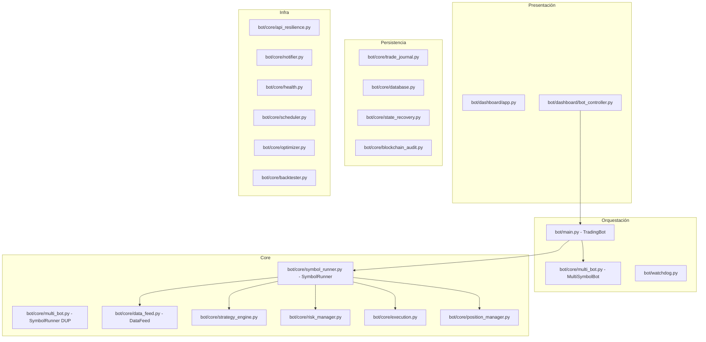
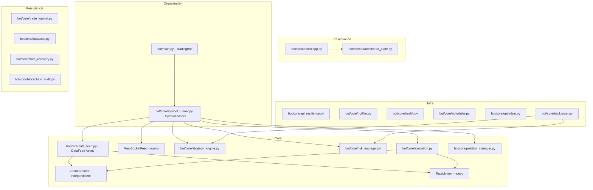

# 🏗️ Plan de Mejora Arquitectónica — Trading Bot v4.0

## Resumen Ejecutivo

Tras analizar ~5,000 líneas de código en 30+ módulos, se identificaron **15 áreas de mejora** organizadas en **5 fases** de implementación. El plan prioriza correcciones críticas (duplicación, bloqueos del event loop) antes que features nuevos (WebSocket, rate limiter).

---

## Estado Actual de la Arquitectura

---

## 🔴 Hallazgos Críticos (FASE 1)

### 1. Duplicación de `SymbolRunner`

**Archivos:** [`bot/core/symbol_runner.py`](bot/core/symbol_runner.py) ↔ [`bot/core/multi_bot.py`](bot/core/multi_bot.py:19)

Ambos archivos definen una clase `SymbolRunner` con **lógica casi idéntica**. `multi_bot.py` parece ser una versión anterior que quedó huérfana. La clase en `multi_bot.py` no usa `TradeJournal.open()` correctamente y tiene diferencias sutiles en el manejo de `stop_event`.

**Solución:** Eliminar [`bot/core/multi_bot.py`](bot/core/multi_bot.py) y consolidar toda la lógica en [`bot/core/symbol_runner.py`](bot/core/symbol_runner.py). La clase `MultiSymbolBot` puede migrarse a [`bot/main.py`](bot/main.py) o eliminarse si [`TradingBot`](bot/main.py:26) ya cubre ese rol.

### 2. DataFeed Síncrono Bloquea el Event Loop

**Archivo:** [`bot/core/data_feed.py`](bot/core/data_feed.py)

Los métodos [`get_klines()`](bot/core/data_feed.py:66), [`get_balance()`](bot/core/data_feed.py:103), [`get_instrument_info()`](bot/core/data_feed.py:112) son **síncronos** y usan `time.sleep()` internamente via el decorador `@api_retry`. Desde [`SymbolRunner.run_cycle()`](bot/core/symbol_runner.py:37) se llaman dentro de `async def` sin `await` ni `asyncio.to_thread()`, **bloqueando todo el event loop** por varios segundos.

**Solución:** Migrar `DataFeed` a async puro:
- Usar `httpx.AsyncClient` en lugar de `requests`
- Crear decorador `@api_retry_async` (ya existe parcialmente en [`api_resilience.py`](bot/core/api_resilience.py:142))
- Todos los métodos deben ser `async def` y llamarse con `await`

### 3. Circuit Breaker Acoplado a DataFeed

**Archivos:** [`bot/core/data_feed.py`](bot/core/data_feed.py:61), [`bot/core/execution.py`](bot/core/execution.py:21)

El `CircuitBreaker` se instancia dentro de `DataFeed`, y [`OrderExecutor`](bot/core/execution.py:16) lo accede como `self.data_feed.circuit_breaker`. Esto crea un acoplamiento innecesario.

**Solución:** El `CircuitBreaker` debe ser una instancia independiente, inyectada tanto a `DataFeed` como a `OrderExecutor`.

---

## 🟡 Hallazgos Medios (FASE 2)

### 4. Falta de Dependency Injection

Múltiples clases instancian sus dependencias directamente:
- [`SymbolRunner.__init__`](bot/core/symbol_runner.py:12): crea `DataFeed()`, `ScalpingStrategy()`, `RiskManager(self.data_feed)`, etc.
- [`BacktestEngine.__init__`](bot/core/backtester.py:157): crea `DataFeed(symbol=..., testnet=False)` — esto significa que el backtester **requiere conexión a Bybit** incluso para modo offline.

**Solución:** Aceptar dependencias por constructor (inyección). Crear interfaces/ABCs para `DataFeed` y `ExchangeGateway` que permitan mocks en tests.

### 5. `RiskException` No Capturada

**Archivo:** [`bot/core/risk_manager.py`](bot/core/risk_manager.py:172)

`register_stop()` lanza `RiskException` cuando se excede el límite de stops diarios, pero **nadie la captura** en [`SymbolRunner.run_cycle()`](bot/core/symbol_runner.py:37). Esto crashea el runner.

**Solución:** Capturar `RiskException` en `run_cycle()` y desactivar el runner gracefulmente en lugar de crashear.

### 6. State Recovery Solo para el Símbolo Principal

**Archivo:** [`bot/main.py`](bot/main.py:154)

[`_save_cycle_state()`](bot/main.py:154) solo guarda estado del primer runner (`self.principal`). En modo multi-símbolo, los demás runners pierden estado al reiniciar.

**Solución:** Iterar sobre `self.runners` y guardar estado de cada uno por separado (claveado por símbolo).

---

## 🟠 Hallazgos de Mejora (FASE 3)

### 7. Solo REST (sin WebSocket)

Actualmente el bot obtiene datos **cada 15 minutos** via REST (`wait_for_next_candle` en [`DataFeed`](bot/core/data_feed.py:150)). Esto significa:
- No puede reaccionar a movimientos intrabarra
- El trailing stop se actualiza con rezago
- No hay tick data

**Solución:** Agregar WebSocket opcional via `pybit` (lo soporta nativamente). Mantener REST como fallback.

### 8. Sin Rate Limiter

No hay control de rate limiting más allá del circuit breaker. En un loop de 15 minutos no es crítico, pero si se agregan más símbolos (actualmente 3 en portfolio), las llamadas API crecen linealmente. [`api_resilience.py`](bot/core/api_resilience.py:128) maneja 429 pero no los previene proactivamente.

**Solución:** Implementar `RateLimiter` con token bucket que limite calls/segundo configurable.

---

## 🔵 Hallazgos de Refactor (FASE 4)

### 9. Dashboard Acoplado vía `self.principal`

[`TradingBot`](bot/main.py:86-90) expone `self.principal`, `self.executor`, `self.risk_mgr`, `self.data_feed` como atajos para el dashboard. Esto es frágil y rompe el encapsulamiento.

**Solución:** El dashboard debe consumir estado a través de `shared_state.py` (que ya existe) o una API REST interna, no accediendo directamente a los componentes internos del bot.

### 10. Side-effects en `config/loader.py`

**Archivo:** [`config/loader.py`](config/loader.py)

Al importar `config/loader.py`, se ejecutan:
- `print("✅ Todas las fases pasaron la validación Pydantic")` (línea 111)
- `print("✅ Portfolio validado con Pydantic")` (línea 121)

Esto causa output no deseado en logs y rompe tests que importan el módulo.

**Solución:** Mover prints a una función `validate()` explícita, y validaciones a un bloque `if __name__ == "__main__"`.

### 11. Tests Insuficientes

Los tests existentes cubren [`config/loader`](tests/test_config_loader.py), [`database`](tests/test_database.py), [`execution`](tests/test_execution.py), [`indicators`](tests/test_indicators.py), [`position_manager`](tests/test_position_manager.py), [`risk_manager`](tests/test_risk_manager.py), [`strategy`](tests/test_strategy.py), [`trade_journal`](tests/test_trade_journal.py). Pero **faltan tests para**:
- [`symbol_runner.py`](bot/core/symbol_runner.py) (crítico — es el orquestador principal)
- [`backtester.py`](bot/core/backtester.py) (muy complejo, 350+ líneas sin tests)
- [`api_resilience.py`](bot/core/api_resilience.py) (circuit breaker + retry)
- [`notifier.py`](bot/core/notifier.py)

**Solución:** Escribir tests unitarios con mocks para estos módulos.

---

## 🟣 Hallazgos de Feature (FASE 5)

### 12. Sin Monitoreo de Latencia de API

No hay tracking de tiempos de respuesta de la API de Bybit. Sería útil para detectar degradación del exchange antes de que falle.

### 13. Sin Datos On-Chain / Sentimiento

La estrategia es puramente técnica (RSI, ADX, ATR, patrones de velas). Podría beneficiarse de señales adicionales como funding rate, open interest, o sentimiento de noticias.

---

## Plan de Implementación Detallado

### FASE 1 — Correcciones Críticas

| # | Tarea | Archivos Afectados | Prioridad |
|---|-------|-------------------|-----------|
| 1.1 | Unificar `SymbolRunner` (eliminar duplicado en `multi_bot.py`) | `multi_bot.py` (eliminar), `symbol_runner.py` (mejorar) | 🔴 Alta |
| 1.2 | Migrar `DataFeed` a async puro | `data_feed.py`, `api_resilience.py` | 🔴 Alta |
| 1.3 | Desacoplar `CircuitBreaker` de `DataFeed` | `data_feed.py`, `execution.py`, `symbol_runner.py` | 🔴 Alta |

### FASE 2 — Mejoras de Robustez

| # | Tarea | Archivos Afectados | Prioridad |
|---|-------|-------------------|-----------|
| 2.1 | Implementar Dependency Injection en módulos core | `symbol_runner.py`, `backtester.py`, `risk_manager.py` | 🟡 Media |
| 2.2 | Capturar `RiskException` en `run_cycle()` | `symbol_runner.py` | 🟡 Media |
| 2.3 | State recovery multi-símbolo | `main.py`, `state_recovery.py` | 🟡 Media |

### FASE 3 — Performance y Escalabilidad

| # | Tarea | Archivos Afectados | Prioridad |
|---|-------|-------------------|-----------|
| 3.1 | WebSocket opcional para datos en tiempo real | `data_feed.py` (nuevo `WebSocketFeed`) | 🟠 Baja-Media |
| 3.2 | Rate limiter proactivo (token bucket) | Nuevo: `rate_limiter.py` | 🟠 Baja-Media |

### FASE 4 — Refactor y Testing

| # | Tarea | Archivos Afectados | Prioridad |
|---|-------|-------------------|-----------|
| 4.1 | Eliminar proxy `self.principal` del dashboard | `main.py`, `bot_controller.py` | 🔵 Baja |
| 4.2 | Eliminar side-effects en `config/loader.py` | `loader.py` | 🔵 Baja |
| 4.3 | Tests para `symbol_runner`, `backtester`, `api_resilience`, `notifier` | `tests/` | 🔵 Baja |

### FASE 5 — Features Avanzados

| # | Tarea | Archivos Afectados | Prioridad |
|---|-------|-------------------|-----------|
| 5.1 | Monitoreo de latencia de API | `health.py`, `data_feed.py` | ⚪ Baja |
| 5.2 | Integración datos on-chain / funding rate | Nuevo módulo | ⚪ Baja |

---

## Diagrama de Arquitectura Objetivo (Post-Refactor)

---

## Riesgos y Consideraciones

1. **Riesgo:** Migrar `DataFeed` a async puro puede introducir bugs si hay métodos que se llaman desde contextos síncronos (ej: watchdog).
   - **Mitigación:** Mantener wrapper sincrónico delgado (`SyncDataFeed`) para watchdog hasta que también se migre.

2. **Riesgo:** Eliminar `multi_bot.py` puede romper imports no detectados.
   - **Mitigación:** Búsqueda exhaustiva de `from bot.core.multi_bot import` en todo el proyecto antes de eliminar.

3. **Riesgo:** Tests existentes pueden depender del comportamiento síncrono de `DataFeed`.
   - **Mitigación:** Actualizar tests en paralelo con la migración async.

4. **Riesgo:** WebSocket aumenta complejidad operativa (reconexión, heartbeat, manejo de lag).
   - **Mitigación:** Implementar con la lib `pybit` que ya maneja reconexión; mantener REST como fallback automático.
