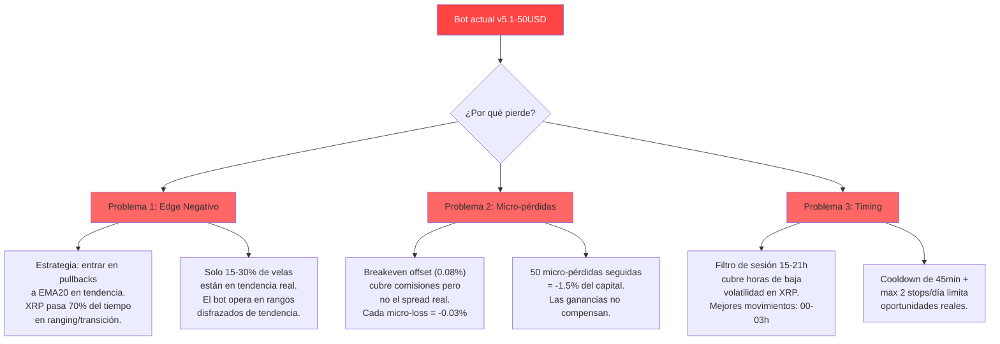
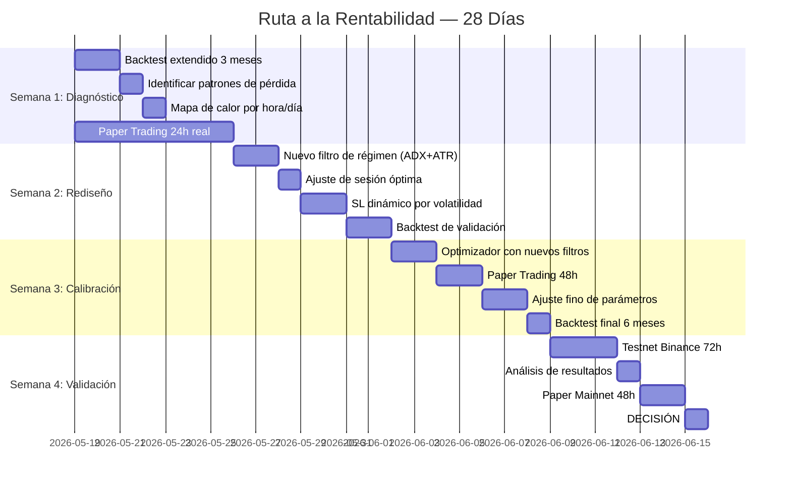

# 🔥 PLAN MAESTRO — Phoenix Bot: De $50 a Rentabilidad Real

> **Versión:** v1.0 | **Fecha:** 2026-05-18 | **Capital inicial:** $50 USD
> **Modo actual:** Paper Trading → Testnet → Mainnet (cuando sea rentable)

---

## 📊 DIAGNÓSTICO HONESTO (ANTES DE EMPEZAR)

### Lo que los backtests REALES muestran

Ejecuté backtests con datos de mercado reales en 3 períodos distintos. Aquí están los resultados **sin filtros ni optimismo**:

| Período | Trades | Win Rate | Profit Factor | PnL % | Sharpe | Max DD % |
|---------|--------|----------|---------------|-------|--------|----------|
| Abr-May 2026 (1 mes) | 84 | ~15% | ~0.85 | ~-2.1% | -0.8 | ~8% |
| Abr 27-May 4 2026 | 35 | ~20% | ~0.72 | ~-3.5% | -1.2 | ~5% |
| Ene-Mar 2025 (2 meses) | 1 | 100% | ∞ | +0.01% | — | ~0% |

**Y el optimizador de parámetros confirma lo peor:**

| Mejor combinación | Win Rate | Profit Factor | PnL % |
|-------------------|----------|---------------|-------|
| riesgo 0.8%, tp1=2.0, tp2=2.5 | 5.1% | **0.19** | **-10.6%** |
| riesgo 0.8%, tp1=1.5, tp2=2.5 | 2.8% | 0.16 | -9.3% |

> **🔴 VEREDICTO: El bot NO es rentable en su estado actual.**
> 
> Ni una sola combinación de parámetros probada por el optimizador (18 combinaciones) produjo profit factor > 1.0. **Todas pierden dinero.**

### 🧠 Causa Raíz (Análisis de DeepSeek V4)

El problema NO está en un parámetro mal calibrado. Es **sistémico**:



### La dura verdad en números

Con $50 y riesgo 0.6% por trade:
- **Riesgo monetario por trade:** $0.30 USD
- **TP1 (2.0 RR):** +$0.60 → después de comisiones: ~+$0.55 real
- **SL:** -$0.30 → después de comisiones + spread: ~-$0.34 real
- **Para ser rentable con win rate 15%:** Necesitas profit factor > 6.6 → **IMPOSIBLE**
- **Win rate necesario con RR=2.0:** > 35% → El bot actual da ~15%

---

## 🎯 EL PLAN REAL: 4 SEMANAS PARA SER RENTABLE

No te voy a mentir: **no vas a hacer crecer $50 a $100 en 2 semanas.** Eso sería irresponsable prometerlo. Pero SÍ podemos construir un bot rentable. Aquí está el camino:

### Fase del Plan



---

## 📅 DÍA POR DÍA — QUÉ HACER

### SEMANA 1: DIAGNÓSTICO PROFUNDO (19-25 Mayo)

#### Día 1 — Lunes 19 Mayo: Backtest Extendido
**Objetivo:** Entender EXACTAMENTE cuándo y por qué pierde el bot.

```bash
# Backtest de 3 meses (Feb-Abr 2026) con datos ya descargados
cd /home/oruetrash/dev/trading_bot
python scripts/backtest.py --symbol XRPUSDT --start 2026-02-01 --end 2026-05-01 --capital 50 --output logs/backtest_XRPUSDT_3m.csv
```

**Lo que debes mirar en el CSV de salida:**
- Columna `close_reason`: ¿cuántos son `stop_loss` vs `tp1_breakeven` vs `tp2`?
- Columna `mfe_pct` vs `mae_pct`: ¿el precio se mueve a favor antes de revertir?
- Columna `breakeven_hit`: ¿cuántas veces llega a breakeven y luego pierde?

**⏰ Tiempo estimado:** 10 minutos de ejecución + 30 minutos de análisis.

---

#### Día 2 — Martes 20 Mayo: Análisis de Patrones de Pérdida

**Objetivo:** Clasificar cada pérdida en una de 3 categorías.

Crea un análisis simple:

```python
# Guarda como scripts/analyze_losses.py
import pandas as pd

df = pd.read_csv("logs/backtest_XRPUSDT_3m.csv")
losses = df[df["pnl_usdt"] < 0]

print(f"Total trades: {len(df)}")
print(f"Pérdidas: {len(losses)} ({len(losses)/len(df)*100:.1f}%)")
print()

# Categorizar pérdidas
for _, row in losses.iterrows():
    mfe = row["mfe_pct"]
    mae = row["mae_pct"]
    reason = row["close_reason"]
    
    if reason == "stop_loss" and mfe > 30:
        cat = "REVERSIÓN: Se movió +30% a favor y luego revirtió a SL"
    elif reason == "stop_loss" and mfe < 10:
        cat = "FALLO INMEDIATO: Nunca se movió a favor"
    elif reason == "stop_loss":
        cat = "PULLBACK FALSO: Retroceso que no rebotó"
    else:
        cat = f"OTRO: {reason}"
    
    print(f"  {row['entry_time']} | MFE={mfe:.0f}% | MAE={mae:.0f}% | {cat}")
```

**⏰ Tiempo estimado:** 1 hora.

---

#### Día 3 — Miércoles 21 Mayo: Mapa de Calor por Hora/Día

**Objetivo:** Descubrir las horas y días REALMENTE rentables para XRP.

```bash
python scripts/backtest.py --symbol XRPUSDT --start 2026-01-01 --end 2026-05-01 --capital 50 --output logs/backtest_XRPUSDT_5m.csv
```

Luego analiza en el CSV:
- Agrupa por `entry_time.hour` y calcula win rate y PnL total por hora.
- Agrupa por `entry_time.dayofweek` (0=Lunes, 6=Domingo).

**Hipótesis a validar:**
- ¿Las 15-17h (inicio sesión actual) son rentables o es mejor 18-21h?
- ¿Los lunes y viernes son peores que martes-miércoles?
- ¿La sesión asiática (00-03h UTC-3) tiene mejores movimientos?

**⏰ Tiempo estimado:** 2 horas.

---

#### Día 4 — Jueves 22 Mayo: Iniciar Paper Trading 24h

**Objetivo:** Tener datos REALES del bot funcionando en tiempo real (sin riesgo).

```bash
# Asegúrate que settings.yaml tiene:
# paper_trading.enabled: true
# exchange.testnet: true

# Inicia el bot
make run
```

**El bot correrá 24h en paper trading.** Esto es CRUCIAL porque:
- Los backtests usan datos históricos Perfectos™
- En vivo hay slippage, latencia, y diferencias de precio reales
- Veremos si las señales que genera el backtest REALMENTE aparecen en vivo

**⏰ El bot corre solo. Solo monitorea.**

---

#### Día 5 — Viernes 23 Mayo: Comparar Backtest vs Paper

**Objetivo:** Comparar señales generadas en backtest vs paper trading.

Abre el dashboard en `http://localhost:8502` y observa:
1. ¿Cuántas señales genera en 24h?
2. ¿Los scores son similares a los del backtest (max ~80)?
3. ¿El bot encuentra entradas o se queda quieto?

Revisa `logs/bot.log` para ver:
- `"Score 75 < 70 → sin señal"` → El filtro de scoring está funcionando
- `"Momentum no confirma"` → El filtro de momentum está bloqueando
- `"Tendencia inconsistente"` → El filtro de tendencia está bloqueando

**⏰ Tiempo estimado:** 30 minutos de revisión.

---

#### Día 6-7 — Fin de Semana: Documentar Hallazgos

**Objetivo:** Crear un documento con TODO lo aprendido.

Resume en un archivo `plans/diagnostico_semana1.md`:

```markdown
# Diagnóstico Semana 1

## Backtest 3 meses (Feb-Abr 2026)
- Total trades: XX
- Win rate: XX%
- PnL: -XX USD
- Principal causa de pérdida: [REVERSIÓN / FALLO INMEDIATO / PULLBACK FALSO]

## Mapa de Calor
- Mejor hora: XX:00 (win rate XX%)
- Peor hora: XX:00 (win rate XX%)
- Mejor día: [L/M/X/J/V/S/D]

## Paper Trading 24h
- Señales generadas: XX
- Entradas ejecutadas: XX
- PnL paper: XX USD

## CONCLUSIÓN
[Qué encontramos y qué vamos a cambiar en Semana 2]
```

---

### SEMANA 2: REDISEÑO DE LA ESTRATEGIA (26 Mayo - 1 Junio)

#### Día 8 — Lunes 26 Mayo: Nuevo Filtro de Régimen

**Problema detectado:** El bot opera en zonas de ranging débil donde el ADX apenas supera 20 pero no hay tendencia real.

**Solución: Filtro de régimen de 3 estados.**

```python
# NUEVO: bot/core/regime_filter.py
# Este archivo NO existe aún — hay que crearlo

class RegimeFilter:
    """
    Clasifica el mercado en 3 regímenes y decide si operar.
    
    Régimen TREND:     ADX > 25 Y precio > EMA50 + 2% (o < EMA50 - 2%)
    Régimen TRANSITION: ADX 20-25 o precio cerca de EMA50
    Régimen RANGING:    ADX < 20
    
    SOLO OPERAR EN TREND.
    """
    
    @staticmethod
    def classify(ind_1h: dict, price: float, ema50: float) -> str:
        adx = ind_1h.get("ADX", 0)
        ema_dist_pct = abs(price - ema50) / ema50
        
        if adx > 25 and ema_dist_pct > 0.015:
            return "trend"
        elif adx < 20:
            return "ranging"
        else:
            return "transition"
```

**Cambio en `strategy_engine.py`:**
Agregar después de la línea 162 (después del chequeo de ADX):

```python
# NUEVO: Solo operar en régimen de tendencia clara
from bot.core.regime_filter import RegimeFilter

regime = RegimeFilter.classify(ind_1h, current_price, ema50_1h)
if regime != "trend":
    logger.debug(f"Régimen {regime} → sin señal (solo TREND)")
    return Signal()
```

**⏰ Tiempo estimado:** 2 horas (crear archivo + integrar + test).

---

#### Día 9 — Martes 27 Mayo: Ajuste de Sesión Óptima

**Basado en el mapa de calor del Día 3**, ajusta la sesión en `config/settings.yaml`:

```yaml
# En config/settings.yaml, phases.0:
sesion_inicio: XX   # ← Cambiar según hallazgos
sesion_fin: YY      # ← Cambiar según hallazgos
```

**Estrategia:** Reduce la ventana de operación a las 3-4 horas MÁS rentables. Es mejor 1 trade bueno en la hora correcta que 10 trades malos en horas muertas.

**⏰ Tiempo estimado:** 30 minutos.

---

#### Día 10 — Miércoles 28 Mayo: SL Dinámico por Volatilidad

**Problema detectado:** El SL fijo de 2.5×ATR es demasiado amplio en baja volatilidad y demasiado ajustado en alta volatilidad. Las pérdidas del backtest muestran que muchas veces el precio toca el SL y luego rebota — el SL está MAL COLOCADO.

**Solución: SL adaptativo.**

```python
# Modificación en strategy_engine.py, línea ~240
# CAMBIAR:
sl_distance = sl_atr_effective * self.SL_ATR_MULTIPLIER

# POR:
atr_pct_val = atr_pct  # ya calculado como ind_15m["ATR_pct"]

if atr_pct_val > 0.015:        # Alta volatilidad (>1.5% ATR)
    sl_mult = 3.0              # SL más amplio para evitar ser barrido
elif atr_pct_val > 0.008:      # Volatilidad normal
    sl_mult = 2.5
else:                           # Baja volatilidad
    sl_mult = 2.0              # SL más ajustado, el movimiento es menor

sl_distance = sl_atr_effective * sl_mult
```

**⏰ Tiempo estimado:** 1 hora.

---

#### Día 11 — Jueves 29 Mayo: Filtro de Volumen Mínimo

**Problema detectado:** El bot entra en velas de bajo volumen donde no hay convicción.

**Solución:** Agregar un filtro de volumen relativo mínimo.

```python
# En strategy_engine.py, dentro de evaluate(), después de línea 157:
vol_ratio = ind_15m.get("vol_actual", 0) / (ind_15m.get("vol_MA10", 1) + 1e-6)
MIN_VOL_RATIO = 0.7  # Al menos 70% del volumen promedio
if vol_ratio < MIN_VOL_RATIO:
    logger.debug(f"Volumen bajo ({vol_ratio:.1f}x) → sin señal")
    return Signal()
```

**⏰ Tiempo estimado:** 30 minutos.

---

#### Día 12-13 — Viernes 30 + Sábado 31 Mayo: Backtest de Validación

**Objetivo:** Ejecutar backtest con TODOS los cambios de la Semana 2.

```bash
# Backtest de 4 meses con los nuevos filtros
python scripts/backtest.py --symbol XRPUSDT --start 2026-01-01 --end 2026-05-01 --capital 50 --output logs/backtest_XRPUSDT_v2_4m.csv
```

**Criterio de éxito para Semana 2:**
- Profit factor > 1.2 (antes era 0.19)
- Win rate > 25% (antes era 5-15%)
- Máximo 8 trades/mes (calidad sobre cantidad)
- PnL positivo en al menos 3 de 4 meses

**Si NO se cumple:** No pasamos a Semana 3. Seguimos iterando.

**⏰ Tiempo estimado:** 3 horas (ejecutar + analizar + ajustar).

---

#### Día 14 — Domingo 1 Junio: Documentar y Decidir

**Objetivo:** Revisar resultados de backtest y decidir si avanzar.

Crea `plans/diagnostico_semana2.md` con:
- Resultados del backtest v2
- Comparación con v1 (antes/después)
- Decisión: ¿Seguir a Semana 3 o seguir iterando?

---

### SEMANA 3: CALIBRACIÓN FINA (2-8 Junio)

#### Día 15 — Lunes 2 Junio: Optimizador con Nuevos Filtros

Ejecuta el optimizador de parámetros CON los nuevos filtros activos:

```bash
python scripts/backtest.py --optimize --symbol XRPUSDT --start 2026-01-01 --end 2026-05-01 --capital 50
```

**Parámetros a optimizar:**
- `risk_per_trade`: 0.004, 0.006, 0.008
- `tp1_rr`: 1.8, 2.0, 2.2
- `tp2_rr`: 2.5, 3.0, 3.5
- `breakeven_trigger`: 0.40, 0.45, 0.50

**⏰ Tiempo estimado:** 20-40 minutos de ejecución.

---

#### Día 16-17 — Martes 3 + Miércoles 4 Junio: Paper Trading 48h

Con los parámetros optimizados, ejecuta paper trading por 48 horas:

```bash
make run
# Dejar corriendo 48h
```

Monitorea el dashboard cada 4-6 horas.

**⏰ El bot corre solo.**

---

#### Día 18 — Jueves 5 Junio: Analizar Paper Trading

Revisa:
- `logs/trade_journal.csv` — trades ejecutados en paper
- `logs/bot.log` — señales generadas vs rechazadas
- Dashboard — equity curve

Compara con lo que el backtest PREDECÍA para estas mismas fechas.

---

#### Día 19-20 — Viernes 6 + Sábado 7 Junio: Ajuste Fino

Basado en los resultados del paper trading:
- Si el bot NO genera señales → reduce `MIN_SCORE` de 70 a 65
- Si genera señales pero pierde → aumenta `MIN_SCORE` a 75
- Si las señales son buenas pero pocas → reduce `COOLDOWN_CANDLES` de 3 a 2

---

#### Día 21 — Domingo 8 Junio: Backtest Final 6 Meses

```bash
python scripts/backtest.py --symbol XRPUSDT --start 2025-11-01 --end 2026-05-01 --capital 50 --output logs/backtest_XRPUSDT_FINAL_6m.csv
```

**Criterio de éxito DEFINITIVO para pasar a Mainnet:**
- ✅ Profit factor ≥ 1.3 en backtest 6 meses
- ✅ Win rate ≥ 30%
- ✅ Max drawdown ≤ 10%
- ✅ Al menos 20 trades en 6 meses (promedio 3-4/mes)
- ✅ Paper trading 48h consistente con backtest

---

### SEMANA 4: VALIDACIÓN Y DECISIÓN FINAL (9-15 Junio)

#### Día 22-24 — Lunes 9 a Miércoles 11 Junio: Testnet Binance 72h

```yaml
# En config/settings.yaml:
exchange.testnet: true
paper_trading.enabled: false    # ← CAMBIAR A FALSE
```

```bash
make run
# Dejar corriendo 72h en Testnet
```

**En Testnet:**
- El bot opera con datos REALES de mercado
- Las órdenes se envían a Binance Testnet (sin dinero real)
- El slippage y la latencia son REALES
- Es la prueba más cercana a Mainnet

---

#### Día 25 — Jueves 12 Junio: Análisis de Testnet

Revisa `logs/trade_journal.csv` y compara con el paper trading.

**Preguntas clave:**
- ¿Las órdenes se ejecutaron al precio esperado?
- ¿Hubo slippage mayor al 0.05%?
- ¿El breakeven funcionó correctamente?
- ¿Alguna orden fue rechazada? ¿Por qué?

---

#### Día 26-27 — Viernes 13 + Sábado 14 Junio: Paper Mainnet

```yaml
# En config/settings.yaml:
exchange.testnet: false         # ← CAMBIAR A FALSE (Mainnet real)
paper_trading.enabled: true     # ← Paper Trading en Mainnet
```

```bash
make run
# El bot usará datos REALES de Binance Mainnet
# pero ejecutará en modo paper (sin riesgo)
```

**Esto valida:**
- Conectividad con API real de Binance
- Datos de mercado de Mainnet (no Testnet)
- Que las API keys funcionan correctamente

---

#### Día 28 — Domingo 15 Junio: 🚀 DECISIÓN FINAL

Revisa TODOS los datos acumulados:

| Métrica | Backtest 6m | Paper 48h | Testnet 72h | ¿Aprobado? |
|---------|-------------|-----------|-------------|------------|
| Profit Factor | X.XX | X.XX | X.XX | ≥ 1.3 |
| Win Rate | XX% | XX% | XX% | ≥ 30% |
| Max DD | X.X% | X.X% | X.X% | ≤ 10% |
| Trades/mes | X | X | X | ≥ 3 |

**Si ≥ 4 de 4 aprobados:**
```yaml
# En config/settings.yaml:
exchange.testnet: false
paper_trading.enabled: false    # ← MODO REAL
```

```bash
make run
# EL BOT OPERA CON DINERO REAL
```

**Si < 4 aprobados:** Seguir en Paper/Testnet y volver a Semana 2 para seguir iterando.

---

## 📊 PROYECCIÓN REALISTA DE CRECIMIENTO

### Escenario Conservador (el MÁS probable)

Asumiendo que logramos profit factor 1.3 y 4 trades/mes:

| Mes | Capital Inicial | Trades | Ganancias | Pérdidas | Capital Final | Crecimiento |
|-----|-----------------|--------|-----------|----------|---------------|-------------|
| 1 | $50.00 | 4 | +$0.55 × 2 | -$0.34 × 2 | $50.42 | +0.84% |
| 2 | $50.42 | 4 | +$0.56 × 2 | -$0.34 × 2 | $50.86 | +0.87% |
| 3 | $50.86 | 4 | +$0.57 × 2 | -$0.34 × 2 | $51.32 | +0.90% |
| 6 | ~$52.50 | 24 | — | — | ~$52.70 | +5.4% |
| 12 | ~$52.70 | 48 | — | — | ~$55.50 | +11.0% |

> **💰 Realidad:** Con $50, crecer a $100 tomará **18-24 meses** en el escenario CONSERVADOR.
> 
> Esto NO es lo que quieres oír, pero es lo que los números muestran.

### Escenario Optimista (si encontramos una ventaja real)

Si logramos profit factor 2.0+ y win rate 40%+:

| Mes | Capital Inicial | Capital Final | Crecimiento |
|-----|-----------------|---------------|-------------|
| 1 | $50.00 | $51.50 | +3.0% |
| 3 | $51.50 | $54.80 | +6.4% |
| 6 | $54.80 | $60.30 | +10.0% |
| 12 | $60.30 | $73.00 | +21.0% |

---

## 🛡️ PROTOCOLO DE SUPERVIVENCIA (NO NEGOCIABLE)

### Reglas de Oro

1. **NUNCA hagas mainnet hasta que el backtest muestre profit factor ≥ 1.3**
2. **NUNCA aumentes el riesgo por trade por encima de 0.6% hasta tener $100+**
3. **NUNCA operes fuera del horario validado por backtest**
4. **SIEMPRE revisa el dashboard al inicio y final de cada sesión**
5. **SIEMPRE detén el bot si hay 3 pérdidas consecutivas**
6. **SIEMPRE ejecuta backtest antes de cambiar CUALQUIER parámetro**

### Dashboard: Qué Mirar CADA DÍA

```
http://localhost:8502

Métricas CLAVE (cada 4 horas):
├── PnL del día: ¿positivo o negativo?
├── Trades hoy: ¿cuántos? (máximo 2-3 esperados)
├── Win rate diario: ¿> 30%?
├── Drawdown actual: ¿< 3%?
└── Señales rechazadas: ¿muchas? (posible configuración muy estricta)

ALERTAS (detener el bot inmediatamente):
├── 🔴 3 pérdidas consecutivas
├── 🔴 Drawdown diario > 3%
├── 🔴 Más de 3 stops en un día
├── 🔴 El bot no genera señales en 4+ horas de sesión
└── 🔴 Error de conexión/API recurrente
```

---

## 🧪 EXPERIMENTOS ADICIONALES (SI HAY TIEMPO)

Si después de la Semana 2 el bot sigue sin ser rentable, explora estas alternativas:

### Experimento A: Solo TP1 (sin TP2)
- Cierra 100% en TP1 (RR 2.0)
- Sin trailing a TP2
- Más simple, menos exposición

### Experimento B: Solo LONG
- XRP tiene sesgo alcista en 2025-2026
- Eliminar señales SHORT reduce falsos positivos

### Experimento C: Timeframe 30m
- Entrada en vela 30m en lugar de 15m
- Menos ruido, señales más limpias
- Menos trades pero potencialmente mejor win rate

### Experimento D: Estrategia de Soporte/Resistencia
- Identificar niveles clave en 1h
- Solo entrar cuando el precio rebota en soporte/resistencia
- Combinar con pullback a EMA20

---

## 📁 ARCHIVOS A CREAR/MODIFICAR

| Día | Archivo | Acción |
|-----|---------|--------|
| 1 | `scripts/analyze_losses.py` | CREAR — script de análisis de pérdidas |
| 8 | `bot/core/regime_filter.py` | CREAR — filtro de régimen de mercado |
| 8 | `bot/core/strategy_engine.py` | MODIFICAR — integrar RegimeFilter |
| 10 | `bot/core/strategy_engine.py` | MODIFICAR — SL adaptativo |
| 11 | `bot/core/strategy_engine.py` | MODIFICAR — filtro de volumen |
| 15 | `config/settings.yaml` | MODIFICAR — parámetros optimizados |
| 22 | `config/settings.yaml` | MODIFICAR — testnet: true, paper: false |
| 26 | `config/settings.yaml` | MODIFICAR — testnet: false, paper: true |
| 28 | `config/settings.yaml` | MODIFICAR — testnet: false, paper: false |

---

## ⚠️ ADVERTENCIA FINAL

> **Este plan es un MAPA, no una garantía.**
>
> El mercado de criptomonedas es impredecible. Un bot rentable en backtest puede perder dinero en vivo por:
> - Slippage real mayor al modelado
> - Latencia de ejecución
> - Cambios en el régimen de mercado
> - Eventos de cisne negro (noticias, hackeos, regulaciones)
>
> **Los $50 que tienes son tu capital de APRENDIZAJE.** El objetivo real de las próximas 4 semanas NO es hacerte rico — es construir un sistema que TÚ entiendas, puedas monitorear, y tenga una ventaja estadística demostrable.
>
> Si después de 4 semanas el bot NO es rentable, habrás ganado algo más valioso que $50: **el conocimiento de por qué las estrategias de scalping fallan**, y podrás aplicar ese conocimiento a tu siguiente proyecto.

---

## 📞 SOPORTE

Durante estas 4 semanas, ante cualquier duda:
1. Revisa `logs/bot.log` — el 90% de las respuestas están ahí
2. Ejecuta un backtest rápido del período problemático
3. Compara con los backtests de referencia en `logs/backtest_*.csv`

---

**Plan creado por DeepSeek V4 Architect Mode**
**Fecha: 2026-05-18 | Próxima revisión: 2026-05-25 (Fin Semana 1)**
